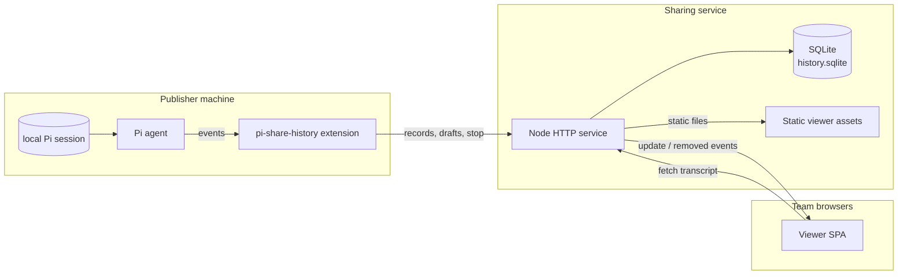
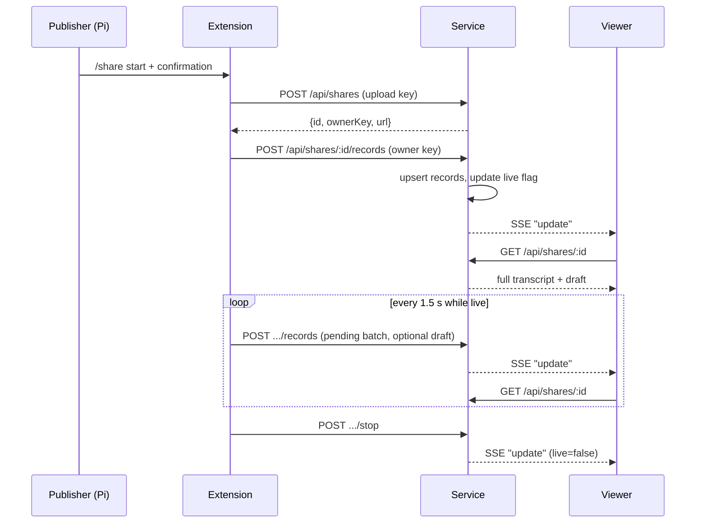
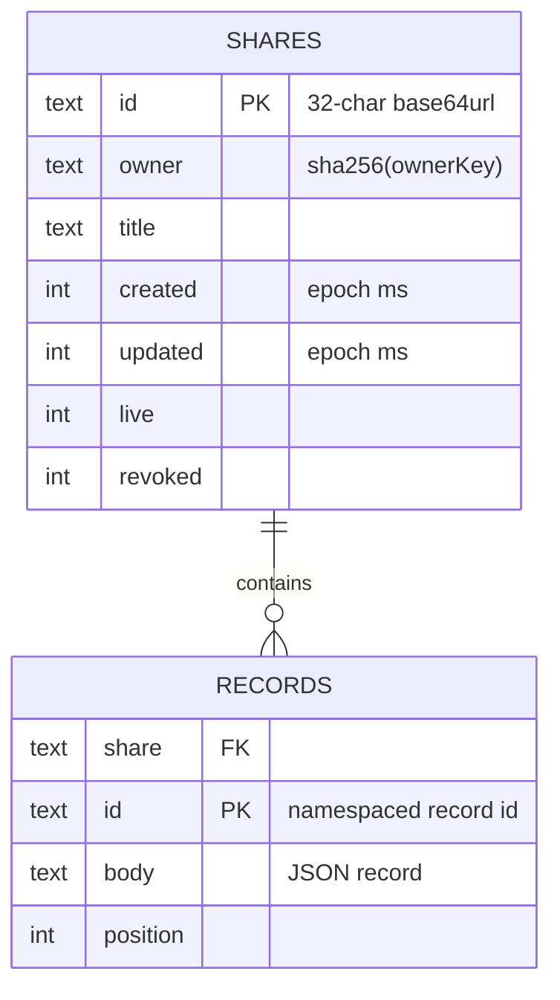
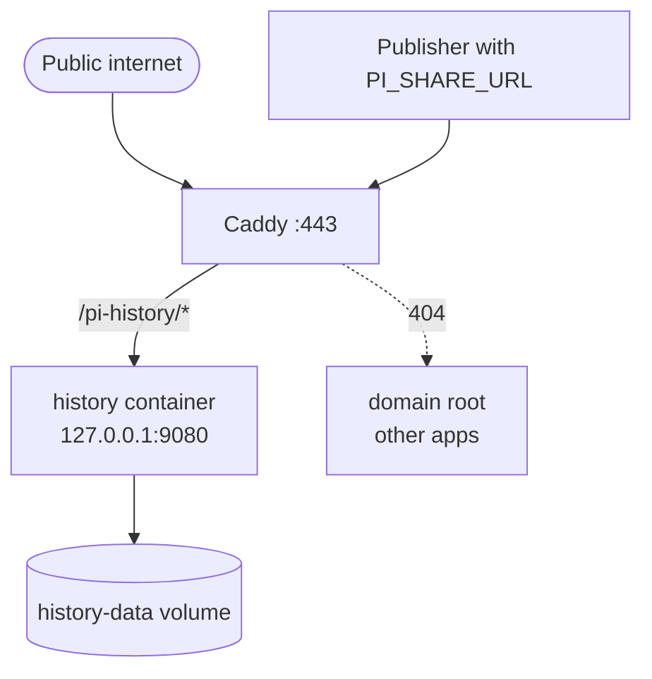

# Architecture

Pi share history publishes a Pi session to a browser in real time. A Pi extension captures the current branch — messages, tool runs, summaries — and uploads it to a small self-hosted Node service. The service stores records in SQLite and streams change notifications to a static browser client over Server-Sent Events.

The design favors operational simplicity over features: no application framework, no build step, no viewer accounts, and a single process with one database file.

## Components

**Extension.** Registers `/share` (or `/pishare` on Pi 1.5+), confirms publication, captures the branch, and keeps a pending map of records. A 1.5 s timer flushes bounded batches of stable record ids. Retries therefore upsert instead of duplicating. Failed uploads stay in memory. A graceful shutdown flushes once. Owner credentials are persisted as a Pi custom entry and never uploaded.

**Service.** A single `http.createServer` handler with hand-written routing. It validates configuration, serves the viewer from memory, owns the SQLite schema, enforces quotas and per-share key auth, and keeps SSE clients per share. Drafts and viewer connections are memory-only.

**Viewer.** Plain scripts served from the service origin. It fetches the whole transcript on every SSE invalidation and reuses DOM nodes by record id. Expansion state and scroll position therefore survive updates. Markdown is rendered in the browser with vendored Marked/DOMPurify. The stored text never changes.

## Data model

Records are stored as opaque JSON bodies with a monotonically increasing `position`. Upserts replace the body but keep the original position, so re-sent streaming messages do not reorder the transcript. Drafts are not part of this model: they exist only in a process-local map.

## Deployment

The container runs as an unprivileged `node` user with a 512 MB memory cap. It serves the viewer and API on one port. SQLite lives in a named volume, and `docker compose down -v` destroys it. Caddy terminates TLS, preserves the `/pi-history` prefix, redirects the legacy `/s/<id>` links, and disables proxy buffering for the SSE endpoint. The app port must stay private behind the proxy.

## Key decisions

- **Dependency-free service.** `node:http` plus built-in `node:sqlite`, no framework or build step, so deployment is a container and a volume.
- **Browser-only Markdown.** Stored text stays exact. Rendering and sanitization happen in the browser against committed vendor assets under a strict CSP.
- **Ephemeral drafts.** Unsent editor text is an explicit opt-in and lives only in memory. It expires after eight seconds and can never become history.
- **Per-share owner keys.** The upload key creates shares. Each share's owner key authorizes changes to that share. The service stores only a hash, and the local Pi session stores the key.
- **Public by default.** The viewer has no login. Confidentiality depends on a VPN or an authenticated proxy, and the UI says so.
- **`/pishare` on new Pi.** Pi 1.5 reserves `/share`. The extension keeps `/share` for older versions and answers to `/pishare` everywhere.

Full specs live in `.ai/spec/`. Start with `.ai/spec/what/system-overview.md` for behavior and `.ai/spec/how/project-structure.md` for code navigation.
